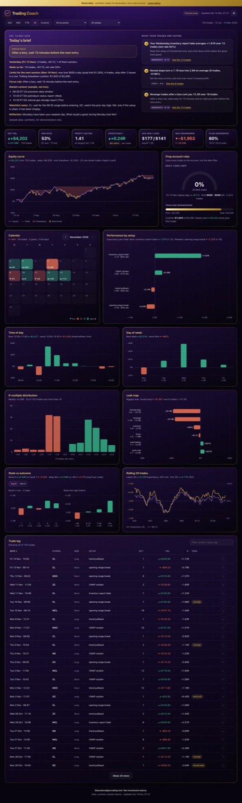

# Trading Coach

Turns Claude into your trading-journal dashboard and morning coach. You keep journaling in Notion; Claude pulls in your trades, links them to what you wrote, and every trading morning gives you a short brief and an up-to-date dashboard.

**[Start the setup →](https://jasonjosephit.github.io/Jo-s-Trading-Platform/setup.html)** · **[See the demo dashboard →](https://jasonjosephit.github.io/Jo-s-Trading-Platform/dashboard.html?demo=1)**

## Quick start (about 20 minutes, no terminal)

1. **Open the setup** link above. It walks you through every step page by page, like setting up a new app: what you trade, which apps you use (it checks each one works with Claude and lines up a second option if not), your risk rules, and connecting Notion and your trading platform.
2. **Download this folder** (the setup gives you the button), unzip it into Documents and name it `Trading Coach`.
3. **Paste one prompt into Claude Desktop** with that folder selected. Claude asks a few questions, imports your history, builds your dashboard and schedules the daily update.

You need a paid Claude plan and [Claude Desktop](https://claude.com/download).

**Other ways in, if you prefer:**
- **Skip the setup page:** open the `Trading Coach` folder in Claude (a Cowork task, or Claude Code) and say *"set up my Trading Coach"*. Claude asks the same questions in chat.
- **Just paste this page's link into Claude Code** and say *"set this up for me"*. It downloads the folder into Documents and starts.
- **Stopped halfway?** Open the folder in Claude again and say *"continue my setup"*. Progress is saved after every step.

## For Claude: start here

If someone gave you this repo or folder, you are setting up a personal trading-journal coach for a non-technical trader, on your own. Nobody else will help her.

1. **Get the folder onto her computer.** If you're already working inside it, skip this. With Claude Code: `git clone https://github.com/JasonJosephIT/Jo-s-Trading-Platform.git ~/Documents/"Trading Coach"` (or download and unzip `archive/refs/heads/main.zip`), then work from there. If you can't write to her computer, send her to the [setup page](https://jasonjosephit.github.io/Jo-s-Trading-Platform/setup.html).
2. **Read [`CLAUDE.md`](CLAUDE.md).** It's your operating manual: the setup steps, the daily flows, the rules (read-only with trading platforms, no trade advice, never invent data) and how to guide her.
3. **Run `python3 scripts/doctor.py`.** It tells you which of the 11 setup steps is next and what state her data is in. Resume from there.
4. **Guide her the way the setup page does:** one step per message, `Step N of 11` headers, numbered choices, exact clicks for anything she must do, and a check that it worked. Do everything else yourself, and save progress with `python3 scripts/doctor.py --mark <step> done "<note>"`.

Reference: [`docs/contracts.md`](docs/contracts.md) (data shapes), [`docs/connectors.md`](docs/connectors.md) (which apps connect and the second options), [`catalog/`](catalog) (researched connector and market-event data), [`prompts/`](prompts) (the prompts she uses).

## What you get

- **Morning brief** before the open: yesterday, your limits, today's focus, scheduled reports with times (EIA, USDA, CFTC, Fed, CPI…), one journal question. In the dashboard and, if you like, on a Notion page for your phone.
- **Dashboard** with win rate, profit factor, expectancy, drawdown, a P&L calendar, best setups, timing, a leak map of what mistakes cost you, and mood/sleep vs results. Prop/funded accounts also get daily-loss and trailing-drawdown gauges.
- **Insights from your own journal**, each with the evidence and sample size behind it.
- **Optional:** market events added to your calendar, quotes and news via Alpha Vantage.

## Works with

Notion (journal) plus your trading platform through a Claude connector where one exists (Interactive Brokers, Webull, Questrade, Gemini, Public; NinjaTrader/Tradovate by link) or a CSV export from any other platform. Full list with links: [docs/connectors.md](docs/connectors.md).

## Privacy

Your data stays on your computer and in your Notion. This public repo contains only empty templates and made-up sample data. The coach is read-only with your platform and never places or suggests trades. See [docs/privacy.md](docs/privacy.md).

*Educational/journaling tool. Not investment advice.*

---

## For maintainers

| Path | |
|---|---|
| `setup.html` | Built from `wizard/` (React + shadcn/ui + Tailwind, single-file build). `cd wizard && npm install && npm run build`. |
| `wizard/src/components/ios/` | iPhone-style onboarding components (nav bar, step progress, grouped lists, segmented control, bottom CTA, copy blocks) on top of shadcn/ui. |
| `dashboard.html`, `assets/` | Vanilla dashboard, works offline on `file://`. Chart.js vendored. |
| `CLAUDE.md` | The operating manual her Claude follows. |
| `scripts/doctor.py` | Setup progress and folder health; her Claude runs it first every session. |
| `.claude/` | Claude Code slash commands (generated from `prompts/prompts.json`) and pre-approved script runs. |
| `prompts/prompts.json` | Single source for every prompt; `node scripts/gen_prompts.mjs` writes `prompts/*.md`, and the wizard imports the JSON. |
| `catalog/` | Researched connector/export catalog and market-event schedule. `node scripts/gen_connectors.mjs` writes `docs/connectors.md`. |
| `scripts/` | `normalize_csv.py`, `build_data.py`, `make_sample.py` (stdlib Python 3.9+). |

Tests: `node --test` and `python3 -m unittest discover -s tests`. Brand: royal purple → black gradients with gold trim (`assets/theme.css`, `wizard/src/index.css`).
